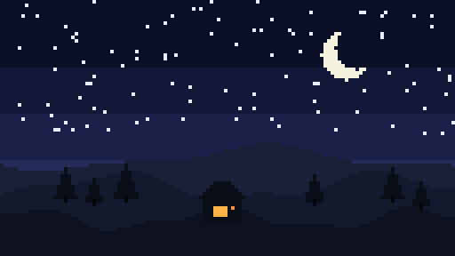
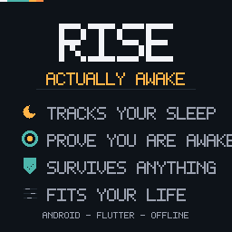
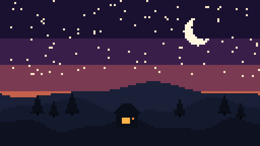

<div align="center">



# Rise

### The alarm clock that makes sure you're actually awake.

<sub>Deep black. One warm accent. No five more minutes.</sub>

&nbsp;



&nbsp;


</div>

---

<div align="center">



<br/>

**Sleep** &nbsp;·&nbsp; **Wake** &nbsp;·&nbsp; **Actually get up**

</div>

---

### Why

Most alarms fail at the only moment that matters: you are awake enough to silence them and asleep
enough to forget why you got up. Rise closes that gap — a native alarm that survives Doze, a mission
you have to complete to dismiss it, and a wake-up check that catches you if you drifted back off.

---

<details>
<summary><b>Getting started</b></summary>

```bash
flutter pub get
flutter run
```

Requires Flutter 3.50+, JDK 21, Android SDK 36.

**Check the alarm actually works** (needs a real device — an emulator cannot reproduce Doze):

1. **Doze** — alarm 2 min out, airplane mode, lock, wait
2. **Force-kill** — force-stop the app, confirm it still rings
3. **Reboot** — reboot, confirm it reschedules
4. **Low battery** — repeat under 15%

</details>

<details>
<summary><b>Status</b></summary>

Rise is early. The foundation is real; most features are not built yet.

| Layer | State |
|---|---|
| Build | ✅ 36/36 tests, 0 analyzer errors |
| Native alarm | ✅ `setAlarmClock`, foreground service, wake lock, boot rescheduling |
| Gentle volume ramp | ✅ Logarithmic gain ramp |
| Sleep-phase detector | ✅ Implemented and unit-tested |
| Night clock | ✅ Dim mode, live hypnogram, pause, stop-and-save |
| Missions | 🟡 8, difficulty not per-mission |
| Stats | 🟡 Score, streak, averages |
| Wake-up check | ❌ Column exists, no behaviour |

</details>

---

<div align="center">

<sub>Android · Flutter · Kotlin · Isar · offline-first · no account required</sub>

</div>

## License

PolyForm Noncommercial 1.0.0 — free for noncommercial use, including by students and for personal
projects. Commercial use requires a separate license. See [LICENSE](LICENSE).

## Contributing

Bug reports and pull requests welcome. One concern per change, and run `flutter analyze` and
`flutter test` first.

## Art

The pixel art is generated, not drawn by hand. Recipes are in `docs/brand/`:

| File | What it is |
|---|---|
| `night.json` → `night.gif` | Night panorama, 6 frames, twinkling stars and a shooting star |
| `dawn.json` → `dawn.gif` | The same landscape at dawn |
| `poster.json` → `poster.png` | The feature poster, drawn with a 5×7 bitmap font |

Regenerate with `npx -y pixelbolt@0.15.0 render <recipe> --out <dir> --gif --gif-scale 4`.