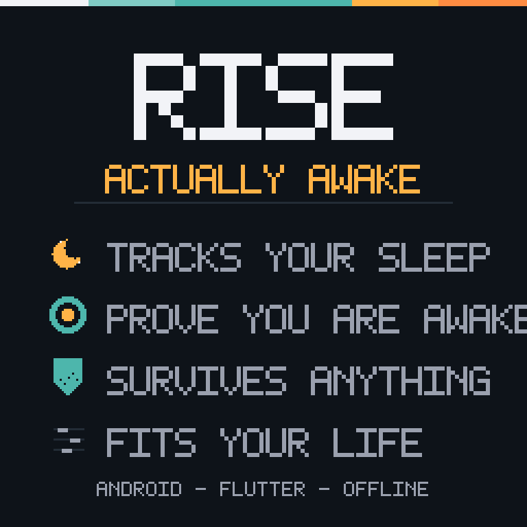
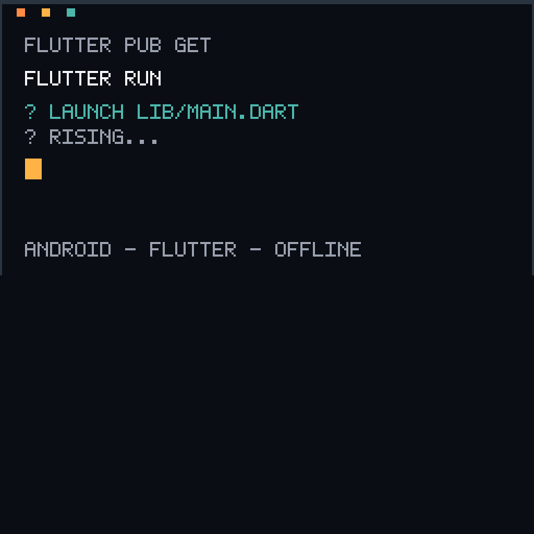

# Rise

### The alarm clock that makes sure you're actually awake.

Deep black. One warm accent. No five more minutes.

&nbsp;

&nbsp;

---

 

**Sleep** &nbsp;·&nbsp; **Wake** &nbsp;·&nbsp; **Actually get up**

---

---

Android · Flutter · Kotlin · Isar · offline-first · no account required

&nbsp;

<a href="docs/brand/README.md">🎨 how the art is made</a>
&nbsp;·&nbsp;
<a href="LICENSE">📜 license</a>
&nbsp;·&nbsp;
<a href="CONTRIBUTING.md">🤝 contributing</a>

